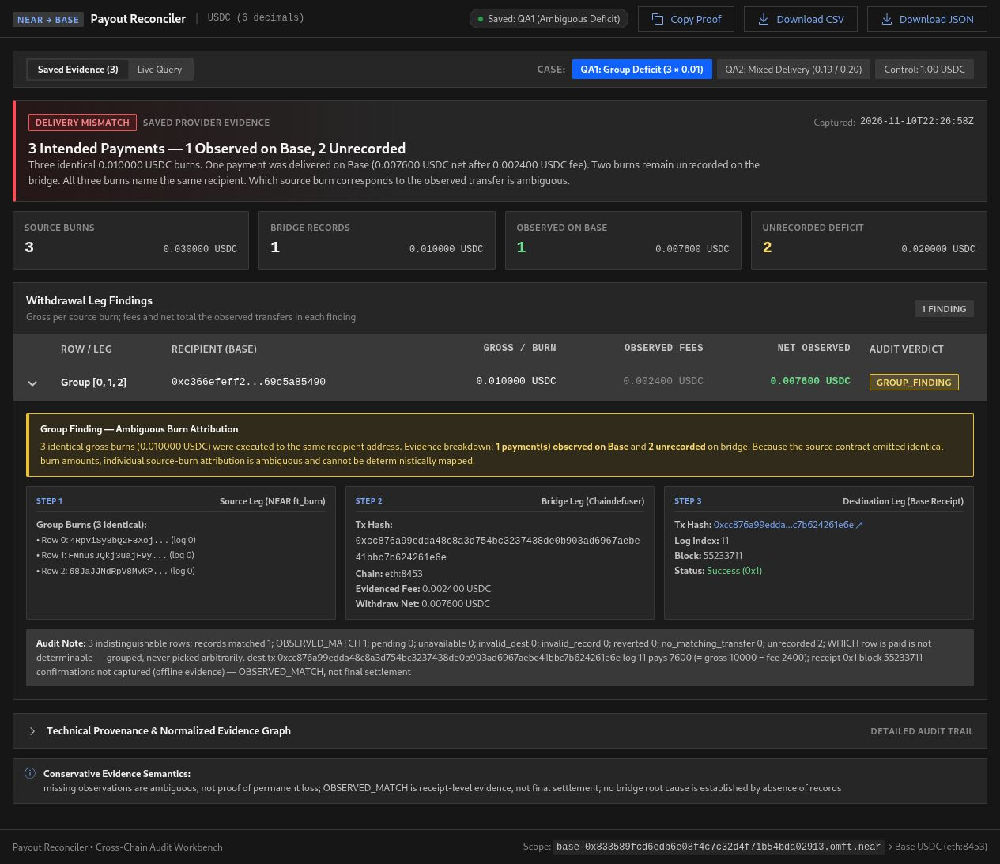

# Payout Reader

**NEAR says the payout executed. Did the USDC arrive on Base?**

Payout Reader is a read-only reconciliation workbench for treasury operators. Enter a NEAR transaction and signer; inspect the source burns, matching Chaindefuser bridge records, and Base USDC transfer receipts together. Export the same findings as JSON, CSV, or Markdown.

[Open the hosted demo](https://payout-reader.up.railway.app) · [Try the grouped deficit](https://payout-reader.up.railway.app/?example=qa1) · [Try the successful control](https://payout-reader.up.railway.app/?example=prod_control)

Built for **NEAR HACKATHON 2026**. Intended tracks: **Real-World Money** (payout reconciliation) and **Social Money** (inspectable treasury payout evidence for Trezu/DAO workflows).



## See the problem in 30 seconds

1. Open **QA1: Group Deficit**. This real mainnet staging transaction contains three identical 0.010000 USDC burns to the **same Base recipient**.
2. See **1 observed transfer and 2 unrecorded burns**. The observed transfer is 0.007600 USDC after an evidenced 0.002400 USDC fee. The reader cannot assign it to a particular source burn; it preserves the group.
3. Expand the finding to inspect NEAR outcome/log identities, the bridge record, and the Base receipt link. Switch to **Control: 1.00 USDC** to see a fully observed payout.
4. **Download JSON**, **Download CSV**, or **Copy Proof** exports the displayed investigation without another provider query.

Saved evidence is explicitly labeled and dated. To refresh an example, select **Live Query** and enter its transaction and signer from the table below. Live mode queries providers; it never substitutes a saved result.

## Why this exists

A source-chain execution result answers a different question from destination delivery. An operator otherwise has to inspect NEAR receipt graphs, query a bridge, account for fees, and find the matching USDC receipt on Base. Equal burns and reusable destination receipts make naive one-to-one matching unsafe.

This prototype joins those observations while retaining gaps, group ambiguity, extra evidence, and provider failures. It does not send payments or recover funds. The mainnet staging cases demonstrate reconciliation behavior; they are not evidence of unpaid customer payroll, a bridge defect, user adoption, or permanent loss.

**NEAR's role is concrete:** the source is executed `ft_burn` evidence from the supported bridged-USDC OMFT contract on NEAR. The application follows that route through Chaindefuser to Base. It does not claim a 1Click integration, agent runtime, new smart contract, or support for every NEAR Intents route.

## Run it locally

Requires **Python 3.13+**. Runtime and offline checks use the standard library: no pip install, Node build, database, wallet, or API key.

```sh
git clone https://github.com/Hesamation/payout-reader.git
cd payout-reader
python3 main.py --check
python3 main.py --serve
```

Expected: checks exit 0 and print `ALL CHECKS PASSED SUCCESSFULLY`. The server prints `Payout Reader server running at http://127.0.0.1:8765/`. Open that address; QA1 loads automatically.

The offline suite currently runs **359 reader checks and 19 application tests (378 total)**. It covers reader regressions/invariants, parity across all 27 fixtures, grouped monetary totals, input validation, API boundaries, and CLI output. It requires no provider access. Test counts are checks, not a guarantee of production readiness.

Optional frontend controller regressions, for contributors with Node 22+: `node tests/test_frontend.js`. This checks all fixture render paths, large exact totals, grouped observations, and browser/CLI CSV data parity; Node is not required to run the app or the Python suite.

### CLI: do X, see Y

```sh
python3 main.py --saved prod_control --json
# summary.overallCode: "ALL_ROWS_OBSERVED"
# rows[0].amounts: gross "1000000", fee "2400", net "997600"

python3 main.py --saved qa1 --json
# summary.overallCode: "MISMATCH"
# rows[0]: GROUP_FINDING, rowIndices [0,1,2], observed 1, unrecorded 2

python3 main.py --saved prod_control --csv
# RFC 4180 CSV, with gross 1.000000 / fee 0.002400 / net 0.997600

python3 main.py --live FD7gA9L45Btw79YvGL49km9nwgWcDJS4QjTid9G4CZFu --signer sponsor.trezu.near --json
# Fresh provider observations, or an explicit conservative inconclusive result.
# Progress goes to stderr; stdout contains only the selected report format.
```

CLI success means the investigation ran; the report's `summary.overallCode` determines its finding. A `MISMATCH` report is not a CLI execution failure. Money is exported as atomic integer strings with exact six-decimal display strings. In group findings, gross is **per burn**, while fee/net sum **observed transfers in that group**; unknown amounts remain absent.

### HTTP API

```sh
curl -sS http://127.0.0.1:8765/api/examples
curl -sS -X POST http://127.0.0.1:8765/api/report \
  -H 'Content-Type: application/json' \
  -d '{"mode":"saved","exampleId":"prod_control"}'
# JSON envelope with summary.overallCode "ALL_ROWS_OBSERVED".
```

`POST /api/report` also accepts `{ "mode": "live", "txHash": "…", "signerId": "…" }`. Invalid inputs return 400; a busy worker returns 429. `GET /healthz` reports service health. Example deep links: `?example=qa1`, `?example=qa2`, `?example=prod_control`.

### Docker (optional)

```sh
docker build -t payout-reader .
docker run -p 8765:8765 payout-reader
docker run payout-reader python3 main.py --check
```

## Real mainnet examples

| Case / saved capture (UTC) | NEAR transaction / signer | Saved finding |
|---|---|---|
| **QA1** · Nov 10, 22:26:58 | [863ZDa…](https://nearblocks.io/txns/863ZDaRijV6j5RiMXf9GaJDBN86e1j2MNevLQNhR1zRe) · `sponsor-staging.trezu.near` | Three 0.01 burns to one recipient; one 0.0076 transfer observed, two burns unrecorded. Source-burn attribution remains grouped. |
| **QA2** · Nov 10, 22:32:14 | [CbyrTs…](https://nearblocks.io/txns/CbyrTsdExtWDbBsdUNqQC65JMBFwXEzkeaGJGmQb2QDz) · `sponsor-staging.trezu.near` | 0.19 → 0.1876 observed; a separate 0.20 burn has no matching bridge record. |
| **Control** · Nov 11, 01:16:56 | [FD7gA9…](https://nearblocks.io/txns/FD7gA9L45Btw79YvGL49km9nwgWcDJS4QjTid9G4CZFu) · `sponsor.trezu.near` | 1.000000 − 0.002400 fee = 0.997600 USDC observed on Base. |

All dates are **2026**. Destination receipts: [QA1](https://basescan.org/tx/0xcc876a99edda48c8a3d754bc3237438de0b903ad6967aebe41bbc7b624261e6e), [QA2](https://basescan.org/tx/0x6c45df6eb72f605d34a63ca4836536125c9c3cb0969a98cffa51ff34af6be708), [Control](https://basescan.org/tx/0x6f845a0325d9762b0584d01dfdf789513ac3e2f33639e3d27f9f60d6055ab21a). Saved captures retain historical observations; confirmation depth in a capture is not a current network reading. Capture provenance is in [reader/PROVENANCE.json](reader/PROVENANCE.json).

## How it works

```text
NEAR transaction + signer
    → receipt graph → executed, supported ft_burn rows
    → Chaindefuser withdrawal records → gross / fee / net
    → Base RPC receipts → USDC Transfer logs
    → conservative reconciliation → workbench / JSON / CSV / Markdown
```

The preserved reader owns extraction, matching, one-use destination log identities, group findings, and verdict precedence. A thin adapter builds a versioned report. The adapter projects observed log identities recorded in reader notes into structured evidence; it preserves all observations in a group and withholds totals if that projection is incomplete. The original notes remain inspectable.

The server uses a fresh subprocess per investigation, a single-worker lock, and a 120-second live deadline. NEAR queries use the reviewed dRPC endpoint with FastNEAR fallback; bridge records come from `bridge.chaindefuser.com/rpc`; Base receipts come from `mainnet.base.org`. Explorer links are for inspection, not data providers. Saved replay makes no network calls.

## Scope and limits

- **One route:** NEAR `base-0x833589fcd6edb6e08f4c7c32d4f71b54bda02913.omft.near` → Base USDC `0x833589fcd6edb6e08f4c7c32d4f71b54bda02913`, chain `eth:8453`, six decimals. Other contracts, tokens, recipients, or incomplete evidence can produce unsupported, invalid, inconclusive, or needs-inspection findings; this is not a universal payout explorer.
- **Provider-trusted observations:** a successful receipt and matching Transfer log support `OBSERVED_MATCH`, not cryptographic proof or final settlement. Source success alone never proves destination delivery.
- **Missing records are unresolved evidence:** unrecorded does not establish why a transfer is absent, who is at fault, permanent loss, or grounds to pay again.
- **Failures remain visible:** pending, reverted, invalid, unmatched, and incomplete observations retain separate findings. On hard worker timeout, the report is inconclusive; partial in-flight evidence is currently discarded. Retry is manual.
- **Small public demo:** one investigation at a time; concurrent requests can receive 429. No persistent history, background monitoring, authentication, payment execution, custody, recovery, or invoice/list reconciliation.
- **Exports:** CSV is a generic reconciliation table for spreadsheets, not a tested QuickBooks import format. “Copy Proof” copies a provider-evidence summary, not a cryptographic proof or direct Trezu/Sputnik API integration. JSON preserves the full report and group metadata.

## Build provenance and hackathon disclosures

The standalone application was implemented on **November 13, 2026**. Its reader was developed during the same hackathon period and imported from the November 11 closeout archive. This is a new NEAR project, not an earlier product ported from another chain. The preserved import is separated from application code in `reader/`; archive and file digests are recorded in [reader/PROVENANCE.json](reader/PROVENANCE.json).

- Original input archive: `inputs/source-closeout/payout-source-closeout-v5-20261111.tar.gz`, SHA-256 `c92edadfc65a46627d673b3e1d265dd2861bdd4fdcdea0a7cd5e72abc8105efe`.
- Preserved engine: `reader/payout_probe.py`, SHA-256 `0ac8f7364292f5e9268bbcc465f433f9ac2ff48c7aeb9d2facfc0f24ce99f4a2`.
- Application work: stdlib HTTP API, worker isolation, adapter, CLI, vanilla HTML/CSS/JavaScript workbench, exports, tests, Docker and hosting configuration. No third-party runtime libraries or frontend templates. Styling follows IBM Carbon design tokens; it does not use the Carbon component library.
- AI coding agents assisted implementation and review. The repository includes reproducible checks; this is not a claim that every behavior has been human-verified.
- Single project entry; no second project is being submitted by this author/team. [MIT license](LICENSE). The repository must be made public before submission and remain public through judging.

Verify the preserved engine independently:

```sh
sha256sum reader/payout_probe.py
# 0ac8f7364292f5e9268bbcc465f433f9ac2ff48c7aeb9d2facfc0f24ce99f4a2
```

## Demo recording guide (90–120 seconds)

1. **0–10s — operator problem, with the app already open:** “NEAR says the treasury payout executed. Did the USDC actually arrive on Base?”
2. **10–35s — one complete live action:** enter the control transaction and signer above in **Live Query**, click **Reconcile**, and show the actual result. If providers are unavailable, state that and switch visibly to dated saved evidence. Never call a saved replay live.
3. **35–65s — the contrast:** open **QA1: Group Deficit**. “This mainnet staging transaction burned three identical amounts to the same recipient. We observe one transfer; two burns have no bridge record. We keep source-burn attribution ambiguous.” Expand the three evidence legs.
4. **65–85s — usable output:** show **Copy Proof** and a JSON/CSV report. Explain that these are provider observations for investigation, not proof of loss or a reason to resend funds.
5. **85–100s — why NEAR and next step:** “We reconcile executed NEAR burns through the bridge to Base receipts, including fees and grouped ambiguity. Read-only, no wallet connection. Try the demo and inspect the code.”

For the human's later release: publish this repository, attach the video to a public X post saying it was built at NEAR HACKATHON, include `@NEARProtocol` and `#NEARHackathon`, and submit both links. Current official deadline: **November 14, 2026 at 23:59 UTC**. Keep the hosted demo available through judging (November 18; ideally November 25). Recheck [the official rules](https://nearhackathon.com/HACKATHON.md) immediately before submission.
